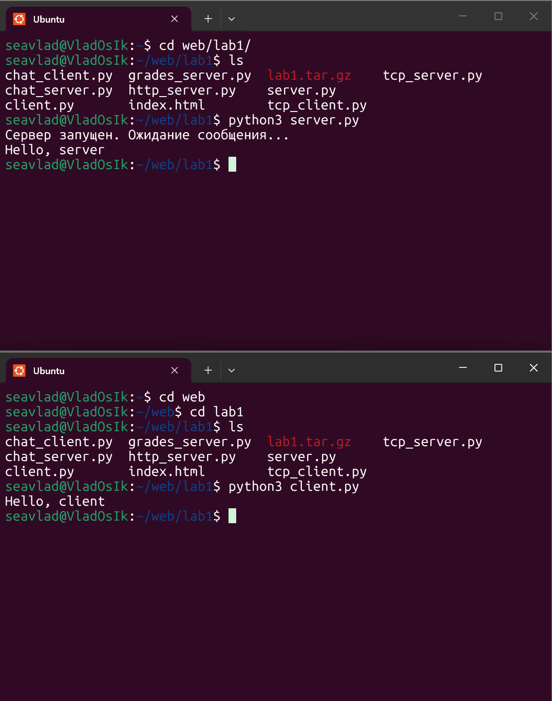
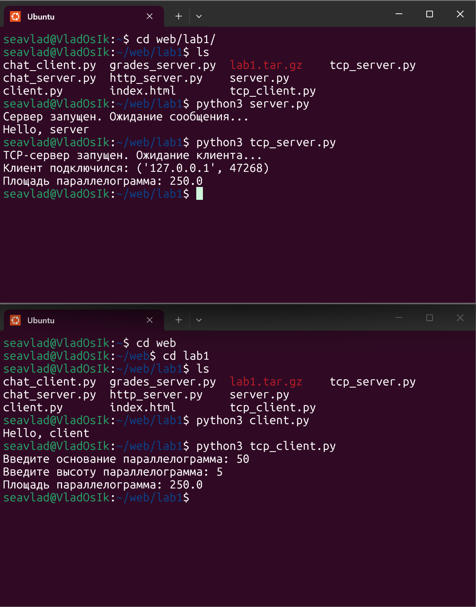
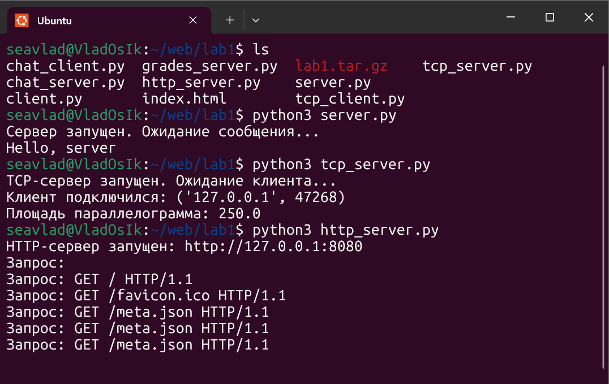
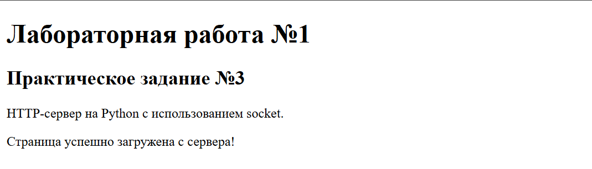
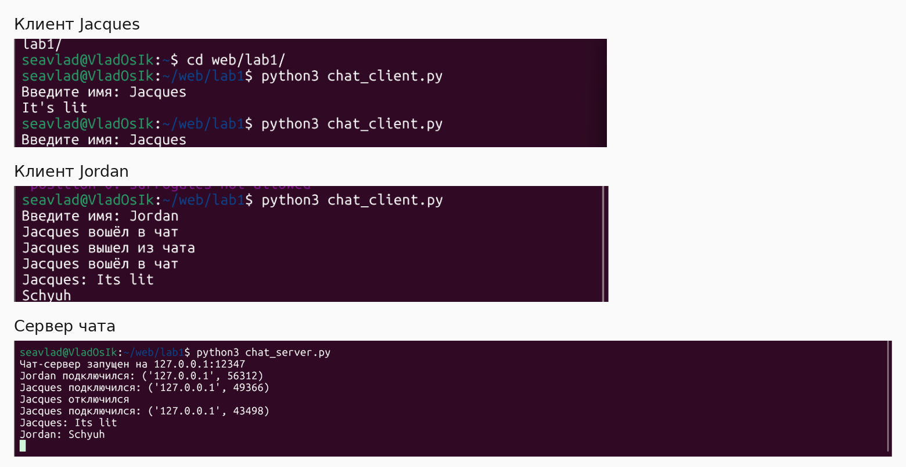
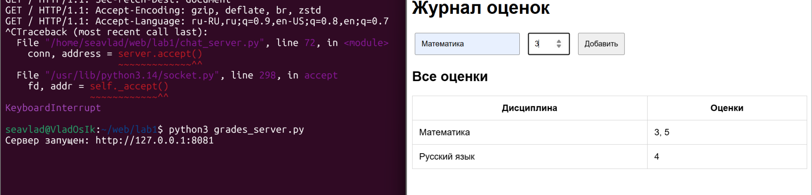

# Лабораторная работа № 1. Работа с сокетами и HTTP

**Дисциплина:** Веб-программирование  
**Студент:** [Фамилия Имя]  
**Группа:** [Номер группы]  
**Дата:** 15.10.2026

## Цель работы

Освоить основы сетевого взаимодействия на Python: обмен UDP-датаграммами, клиент-серверную связь по TCP, передачу HTML через HTTP, поддержку нескольких клиентов с помощью потоков, обработку HTTP-методов GET и POST.

## Используемые средства

- Python 3, стандартные библиотеки `socket`, `threading`, `html`, `urllib.parse`.
- Ubuntu (WSL), терминал, браузер.
- Локальный интерфейс `127.0.0.1`.

## Практическая часть


### Задание 1. UDP-сервер и клиент

**Задача.** Реализовать обмен сообщениями по протоколу UDP.

**Ход работы.** Сервер создаёт датаграммный сокет `AF_INET/SOCK_DGRAM` и слушает адрес `127.0.0.1:12345`. Клиент отправляет сообщение `Hello, server` методом `sendto`. Сервер получает датаграмму методом `recvfrom` и отвечает `Hello, client`. UDP не создаёт постоянного соединения.

**Запуск:** в двух терминалах из папки `task_1` последовательно выполнить `python3 server.py` и `python3 client.py`.

**Результат.** На сервере выведено `Hello, server`, у клиента — `Hello, client`. Обмен подтверждён скриншотом.




**Листинг исходного кода:**


Файл [`task_1/server.py`](task_1/server.py):

```python
import socket

server = socket.socket(socket.AF_INET, socket.SOCK_DGRAM)
server.bind(("127.0.0.1", 12345))

print("Сервер запущен. Ожидание сообщения...")

data, address = server.recvfrom(1024)
print(data.decode())

server.sendto("Hello, client".encode(), address)
server.close()
```


Файл [`task_1/client.py`](task_1/client.py):

```python
import socket

client = socket.socket(socket.AF_INET, socket.SOCK_DGRAM)
client.sendto("Hello, server".encode(), ("127.0.0.1", 12345))

data, address = client.recvfrom(1024)
print(data.decode())

client.close()
```


### Задание 2. TCP-сервер: площадь параллелограмма

**Задача.** По данным клиента вычислить площадь параллелограмма.

**Ход работы.** Сервер использует TCP-сокет `AF_INET/SOCK_STREAM` и принимает одно соединение на `127.0.0.1:12346`. Клиент считывает основание `a` и высоту `h`, отправляет их серверу, получает вычисленное число и выводит его.

**Формула:** $S = a\cdot h$.

**Запуск:** в двух терминалах из папки `task_2` выполнить `python3 tcp_server.py` и `python3 tcp_client.py`.

**Результат.** Для `a = 50` и `h = 5` получено `S = 250.0`. Проверка: `50 × 5 = 250`.




**Листинг исходного кода:**


Файл [`task_2/tcp_server.py`](task_2/tcp_server.py):

```python
import socket 

server = socket.socket(socket.AF_INET, socket.SOCK_STREAM)
server.bind(("127.0.0.1", 12346))
server.listen(1)

print("TCP-сервер запущен. Ожидание клиента...")

conn, address = server.accept()

with conn:
    print("Клиент подключился:", address)
    data = conn.recv(1024).decode()
    
    a, h = map(float, data.split())
    s = a * h

    print("Площадь параллелограмма:", s)
    conn.sendall(str(s).encode())

server.close()
```


Файл [`task_2/tcp_client.py`](task_2/tcp_client.py):

```python
import socket

a = float(input("Введите основание параллелограмма: "))
h = float(input("Введите высоту параллелограмма: "))

client = socket.socket(socket.AF_INET, socket.SOCK_STREAM)
client.connect(("127.0.0.1", 12346))

client.sendall(f"{a} {h}".encode())

result = client.recv(1024).decode()
print("Площадь параллелограмма:", result)

client.close()
```


### Задание 3. HTTP-сервер статической HTML-страницы

**Задача.** Создать HTTP-сервер на сокетах, который отправляет клиенту HTML-страницу.

**Ход работы.** TCP-сервер слушает порт `8080`, принимает запрос браузера, читает содержимое файла `index.html` и формирует ответ со статусом `200 OK`, типом `text/html; charset=utf-8` и длиной тела ответа.

**Запуск:** из папки `task_3` выполнить `python3 http_server.py`, затем открыть `http://127.0.0.1:8080/`.

**Результат.** В терминале получен запрос `GET / HTTP/1.1`. В браузере отображена страница «Лабораторная работа №1 / Практическое задание №3».






**Листинг исходного кода:**


Файл [`task_3/http_server.py`](task_3/http_server.py):

```python
import socket

server = socket.socket(socket.AF_INET, socket.SOCK_STREAM)
server.setsockopt(socket.SOL_SOCKET, socket.SO_REUSEADDR, 1)
server.bind(("127.0.0.1", 8080))
server.listen(5)

print("HTTP-сервер запущен: http://127.0.0.1:8080")

while True:
    conn, address = server.accept()

    with conn:
        request = conn.recv(4096).decode("utf-8", errors="replace")
        print("Запрос:", request.splitlines()[0] if request else "")

        with open("index.html", "rb") as file:
            content = file.read()

        headers = (
            "HTTP/1.1 200 OK\r\n"
            "Content-Type: text/html; charset=utf-8\r\n"
            f"Content-Length: {len(content)}\r\n"
            "Connection: close\r\n"
            "\r\n"
        )

        conn.sendall(headers.encode("utf-8") + content)
```


Файл [`task_3/index.html`](task_3/index.html):

```html
<!DOCTYPE html>
<html lang="ru">
<head>
    <meta charset="UTF-8">
    <title>Лабораторная работа №1</title>
</head>
<body>
    <h1>Лабораторная работа №1</h1>
    <h2>Практическое задание №3</h2>
    <p>HTTP-сервер на Python с использованием socket.</p>
    <p>Страница успешно загружена с сервера!</p>
</body>
</html>
```


### Задание 4. Многопользовательский TCP-чат

**Задача.** Реализовать обмен сообщениями нескольких клиентов через TCP-сервер.

**Ход работы.** Сервер слушает `127.0.0.1:12347` и создаёт отдельный поток `threading.Thread` для каждого подключения. Словарь `clients` хранит имена подключённых пользователей, а `threading.Lock` защищает операции с ним. Метод `broadcast` рассылает сообщения остальным участникам. Клиент имеет отдельный поток чтения входящих сообщений. Команда `/exit` завершает сеанс.

**Запуск:** из папки `task_4` выполнить `python3 chat_server.py`, затем дважды `python3 chat_client.py` в отдельных терминалах, указав разные имена.

**Результат.** Клиенты Jacques и Jordan обменялись сообщениями `Its lit` и `Schyuh`; сервер вывел события подключения и полученные сообщения. Ниже представлены отдельные фрагменты одного пользовательского скриншота, обрезанные для удобства чтения.




**Листинг исходного кода:**


Файл [`task_4/chat_server.py`](task_4/chat_server.py):

```python
import socket
import threading

HOST = "127.0.0.1"
PORT = 12347

clients = {}
lock = threading.Lock()


def broadcast(message, sender=None):
    with lock:
        recipients = [
            client for client in clients
            if client != sender
        ]

    for client in recipients:
        try:
            client.sendall((message + "\n").encode())
        except OSError:
            pass


def handle_client(conn, address):
    name = None

    try:
        with conn:
            reader = conn.makefile("r", encoding="utf-8")
            name = reader.readline().strip()

            if not name:
                return

            with lock:
                clients[conn] = name

            print(f"{name} подключился: {address}")
            broadcast(f"{name} вошёл в чат", conn)

            for line in reader:
                message = line.strip()

                if message == "/exit":
                    break

                if message:
                    print(f"{name}: {message}")
                    broadcast(f"{name}: {message}", conn)

    except (OSError, UnicodeError):
        pass

    finally:
        with lock:
            clients.pop(conn, None)

        if name:
            print(f"{name} отключился")
            broadcast(f"{name} вышел из чата")


server = socket.socket(socket.AF_INET, socket.SOCK_STREAM)
server.setsockopt(socket.SOL_SOCKET, socket.SO_REUSEADDR, 1)
server.bind((HOST, PORT))
server.listen()

print(f"Чат-сервер запущен на {HOST}:{PORT}")

while True:
    conn, address = server.accept()

    thread = threading.Thread(
        target=handle_client,
        args=(conn, address),
        daemon=True
    )
    thread.start()
```


Файл [`task_4/chat_client.py`](task_4/chat_client.py):

```python
import socket
import threading

HOST = "127.0.0.1"
PORT = 12347

client = socket.socket(socket.AF_INET, socket.SOCK_STREAM)
client.connect((HOST, PORT))

name = input("Введите имя: ")
client.sendall((name + "\n").encode())


def receive_messages():
    while True:
        try:
            data = client.recv(1024)

            if not data:
                break

            print(data.decode(), end="", flush=True)

        except OSError:
            break


threading.Thread(target=receive_messages, daemon=True).start()

try:
    while True:
        message = input()

        client.sendall((message + "\n").encode())

        if message == "/exit":
            break

except (KeyboardInterrupt, EOFError, OSError, UnicodeError):
    pass

finally:
    client.close()
```


### Задание 5. Журнал оценок с HTTP GET/POST

**Задача.** Реализовать HTTP-сервер, показывающий журнал оценок и позволяющий добавлять записи через веб-форму.

**Ход работы.** Сервер слушает `127.0.0.1:8081`. При `GET /` генерируется HTML-страница со списком дисциплин и оценок. При `POST /` сервер считывает `Content-Length`, получает тело формы, декодирует данные с помощью `parse_qs`, проверяет название дисциплины и оценку в диапазоне 1–5, добавляет её в словарь `grades` и перенаправляет браузер ответом `303 See Other` на главную страницу. Название дисциплины экранируется функцией `html.escape`, чтобы не вставлять в HTML произвольную разметку.

**Запуск:** из папки `task_5` выполнить `python3 grades_server.py`, затем открыть `http://127.0.0.1:8081/` и отправить форму.

**Результат.** В браузере отображён журнал с предметами «Математика» и «Русский язык» и имеющимися оценками. Отправка формы POST проверена пользователем отдельно; приложенный снимок фиксирует отображение страницы (GET), а не состояние после конкретного тестового POST.

**Ограничение реализации:** оценки хранятся в оперативной памяти процесса и будут потеряны после перезапуска сервера.




**Листинг исходного кода:**


Файл [`task_5/grades_server.py`](task_5/grades_server.py):

```python
import socket
from html import escape
from urllib.parse import parse_qs

HOST = "127.0.0.1"
PORT = 8081

grades = {}


def make_page():
    rows = ""

    for subject, marks in grades.items():
        rows += (
            f"<tr><td>{escape(subject)}</td>"
            f"<td>{', '.join(map(str, marks))}</td></tr>"
        )

    return f"""<!DOCTYPE html>
<html lang="ru">
<head>
    <meta charset="UTF-8">
    <title>Журнал оценок</title>
    <style>
        body {{ font-family: Arial; max-width: 700px;
                margin: 50px auto; }}
        input, button {{ padding: 10px; margin: 5px; }}
        table {{ width: 100%; border-collapse: collapse; }}
        th, td {{ border: 1px solid #ccc; padding: 12px; }}
    </style>
</head>
<body>
    <h1>Журнал оценок</h1>

    <form method="POST" action="/">
        <input name="subject" placeholder="Дисциплина" required>
        <input name="grade" type="number" min="1" max="5"
               placeholder="Оценка" required>
        <button type="submit">Добавить</button>
    </form>

    <h2>Все оценки</h2>
    <table>
        <tr><th>Дисциплина</th><th>Оценки</th></tr>
        {rows}
    </table>
</body>
</html>"""


def handle_client(conn):
    with conn:
        request = b""

        while b"\r\n\r\n" not in request:
            chunk = conn.recv(4096)
            if not chunk:
                return
            request += chunk

        header_data, body = request.split(b"\r\n\r\n", 1)
        lines = header_data.decode("iso-8859-1").split("\r\n")
        method, path, _ = lines[0].split()

        headers = {}
        for line in lines[1:]:
            if ":" in line:
                key, value = line.split(":", 1)
                headers[key.lower()] = value.strip()

        if method == "POST" and path == "/":
            length = int(headers.get("content-length", "0"))

            while len(body) < length:
                chunk = conn.recv(4096)
                if not chunk:
                    return
                body += chunk

            form = parse_qs(body[:length].decode("utf-8"))
            subject = form.get("subject", [""])[0].strip()
            grade = form.get("grade", [""])[0]

            if subject and grade.isdigit() and 1 <= int(grade) <= 5:
                grades.setdefault(subject, []).append(int(grade))

            response = (
                "HTTP/1.1 303 See Other\r\n"
                "Location: /\r\n"
                "Content-Length: 0\r\n"
                "Connection: close\r\n\r\n"
            ).encode("utf-8")

        elif method == "GET" and path == "/":
            content = make_page().encode("utf-8")
            response = (
                "HTTP/1.1 200 OK\r\n"
                "Content-Type: text/html; charset=utf-8\r\n"
                f"Content-Length: {len(content)}\r\n"
                "Connection: close\r\n\r\n"
            ).encode("utf-8") + content

        else:
            content = b"Not Found"
            response = (
                "HTTP/1.1 404 Not Found\r\n"
                "Content-Type: text/plain; charset=utf-8\r\n"
                f"Content-Length: {len(content)}\r\n"
                "Connection: close\r\n\r\n"
            ).encode("utf-8") + content

        conn.sendall(response)


server = socket.socket(socket.AF_INET, socket.SOCK_STREAM)
server.setsockopt(socket.SOL_SOCKET, socket.SO_REUSEADDR, 1)
server.bind((HOST, PORT))
server.listen(5)

print(f"Сервер запущен: http://{HOST}:{PORT}")

try:
    while True:
        conn, address = server.accept()
        handle_client(conn)
except KeyboardInterrupt:
    print("\nСервер остановлен")
finally:
    server.close()
```


## Вывод

В ходе лабораторной работы реализованы пять сетевых приложений на Python: UDP-обмен, TCP-вычисление площади, HTTP-выдача HTML, многопользовательский чат и HTTP-журнал оценок. Практически изучены функции `bind`, `listen`, `accept`, `connect`, `sendall`, `recv`, `sendto`, `recvfrom`, создание потоков для параллельных подключений и обработка GET/POST-запросов. Приложения проверены локально в Ubuntu и браузере.

## Структура материалов

- `task_1` — UDP-клиент и сервер;
- `task_2` — TCP-клиент и сервер;
- `task_3` — HTTP-сервер и HTML;
- `task_4` — многопользовательский чат;
- `task_5` — HTTP-сервер журнала оценок;
- `screenshots` — снимки результатов работы программ.

**Примечание.** Отчёт составлен по предоставленному коду и фактическим проверкам; перед отправкой необходимо заполнить ФИО и группу, а требования к форме сдачи сверить с актуальным заданием преподавателя.
